<p align="center">
  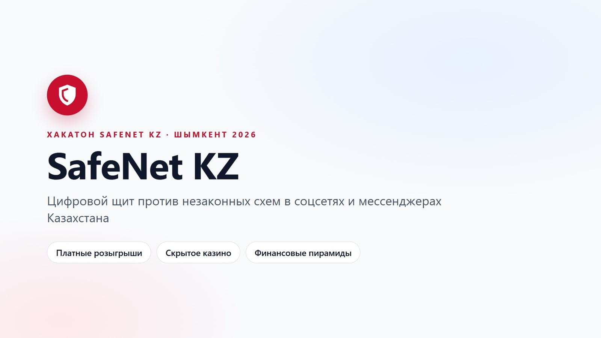
</p>

<p align="center">
  <b>Находим признаки платных розыгрышей, скрытой рекламы казино и финансовых пирамид —<br>
  на русском, казахском и транслите, в текстах, скриншотах, видео и целых группах.</b>
</p>

<p align="center">
  
  
  
  
</p>

<p align="center">
  
  
  
  
  
  
</p>

<p align="center">
  <a href="#-за-30-секунд">За 30 секунд</a> ·
  <a href="#-что-сдаём">Что сдаём</a> ·
  <a href="#-тур-по-продукту">Тур по продукту</a> ·
  <a href="#-как-это-работает">Как это работает</a> ·
  <a href="#-честные-метрики">Метрики</a> ·
  <a href="#-быстрый-старт">Быстрый старт</a> ·
  <a href="#-устройство">Устройство</a>
</p>

---

## ⚡ За 30 секунд

**SafeNet KZ** — прототип для хакатона SafeNet KZ (Шымкент, 2026). Один движок закрывает все три трека:

| | Трек | Что находит |
|:-:|---|---|
| 🎟️ | **Розыгрыши под контролем** | платное участие (взнос, «номера», перевод на Kaspi), случайный выбор победителя, доход организатора — и **отличает бесплатные конкурсы** |
| 🎰 | **Скрытая игра** | нативная реклама казино («как я поднял»), промокоды, трекинговые ссылки, зеркала, стримы, каналы-прокладки |
| 📈 | **Стоп-пирамида** | нереалистичная доходность («вложи X → получи Y», % в день), доход от привлечения, давление, «выплаты», роли в группе |

Каждое срабатывание — с **дословной цитатой**, источником и вкладом в балл. Итог — уровень
**низкий / средний / высокий** и очередь для аналитика, отсортированная по «риск × охват».

> [!IMPORTANT]
> Система **не объявляет схему незаконной**: она показывает признаки возможного нарушения.
> Законность проверяет специалист, и каждое решение остаётся за человеком.

### Киллер-фичи

- 🔍 **Объяснимость до последнего балла** — Σ вкладов признаков = итоговый балл; «что если» показывает балл без каждого признака.
- 🛡️ **Мало ложных срабатываний** — гейты по трекам: бесплатный конкурс, банковский депозит и новость о задержании не поднимаются в риск.
- 🎭 **Снятие маскировки** — `к@зин0`, `К А З И Н О`, латиница-двойник, транслит, эмодзи `💵➡️💵💵`, суммы прописью, казахский без казахской раскладки.
- 🖼️ **Мультимодальность** — OCR скриншотов on-prem (Tesseract rus+kaz+eng), видео и эфиры: речь, кадры, визуальные теги.
- 👥 **Группа целиком** — экспорт Telegram / WhatsApp → организатор, кураторы, шаблонные «отзывы о выплатах».
- 🕸️ **Кампании и граф связей** — аккаунты, связанные одним промокодом, Kaspi-картой или каналом, складываются в схему.
- 🧭 **Адаптация** — система сама находит новые слова мошенников, которых ещё нет в методике.
- 🤖 **AI-ассистент аналитика** — вызывает инструменты (сводка, очередь, граф) и отвечает только фактами из базы.

---

## 📦 Что сдаём

| № | Результат | Где |
|:-:|---|---|
| 1 | **Работающий прототип** | `docker compose up` → веб-интерфейс http://localhost:5173 |
| 2 | **Презентация на 5 минут** | [docs/SafeNet_KZ.pptx](docs/SafeNet_KZ.pptx) · [presentation.html](presentation.html) |
| 3 | **Видео-демо, ~3 минуты** | [docs/SafeNet_KZ_demo.mp4](docs/SafeNet_KZ_demo.mp4) (озвучка, субтитры) |
| 4 | **Методика**: признаки и расчёт риска | [docs/METHODOLOGY.md](docs/METHODOLOGY.md) · экран «Метрики и методика» |
| 5 | **Метрики**: precision, recall, FPR | [docs/METRICS.md](docs/METRICS.md) · `python -m scripts.evaluate_safenet` |
| 6 | **План внедрения** | [docs/ROADMAP_SAFENET.md](docs/ROADMAP_SAFENET.md) |

---

## 🧭 Тур по продукту

### Обзор: три трека на одном экране

Риск по каждому треку, суммарный охват, организаторы и сообщества, очередь самых опасных материалов.

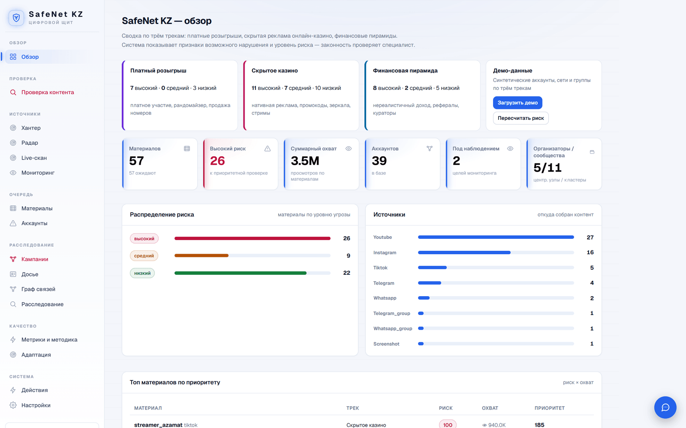

### Каждое срабатывание объяснено

Пост на казахском «Ұтыс ойыны! Қатысу ақылы — 500 тг, Kaspi-ге аударыңыз» → **100 / 100, платный розыгрыш**.
У каждого признака — цитата, источник (подпись, речь, скриншот, чат), вклад в балл и балл без него.

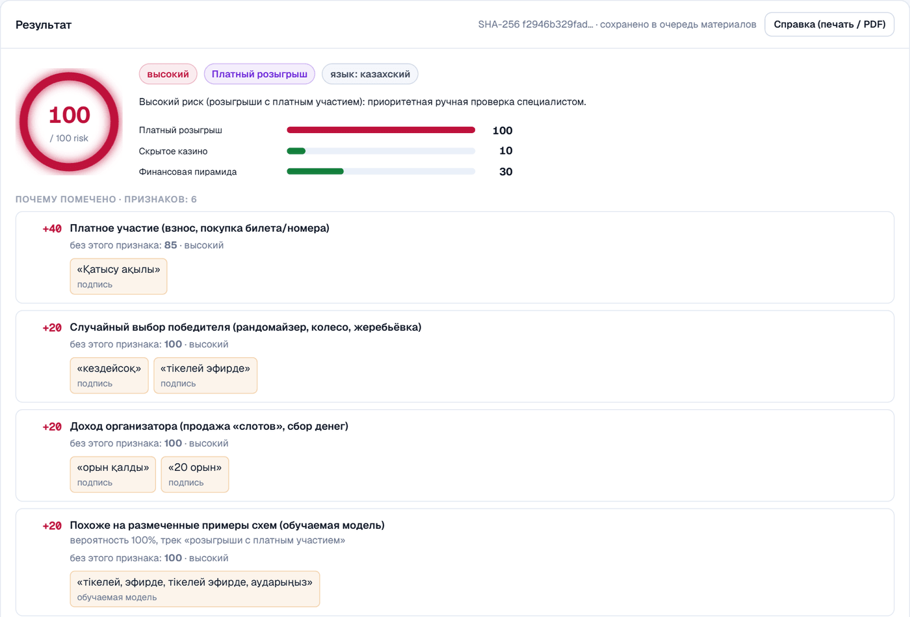

<table>
<tr>
<td width="50%" valign="top">

**Обычный конкурс — низкий риск.** Бесплатный розыгрыш с рандомайзером не попадает в выборку:
гейт «нет платного участия» снижает балл, и аналитик видит эту поправку строкой.

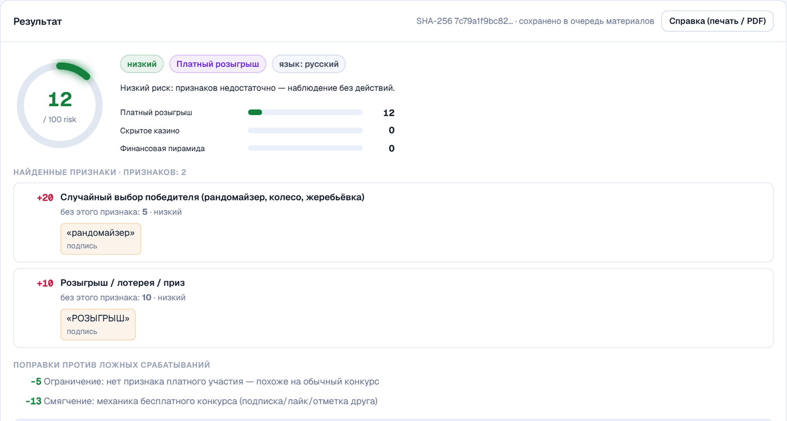

</td>
<td width="50%" valign="top">

**Маскировка снимается.** `к@зино`, разрядка, транслит и эмодзи нормализуются; у признака видно,
*как* его прятали — «скрыто подменой символов», «закодировано эмодзи».

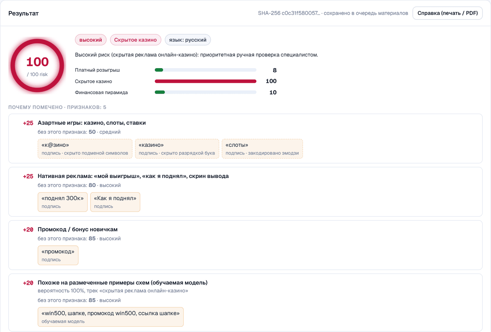

</td>
</tr>
</table>

### Скриншоты и видео

<table>
<tr>
<td width="50%" valign="top">

**Текст внутри картинки.** Карточка «инвест-клуба» распознаётся локальным OCR, а числовой анализ
переводит «3% в день» в ≈ 1000% годовых против 14–16% по банковским вкладам.

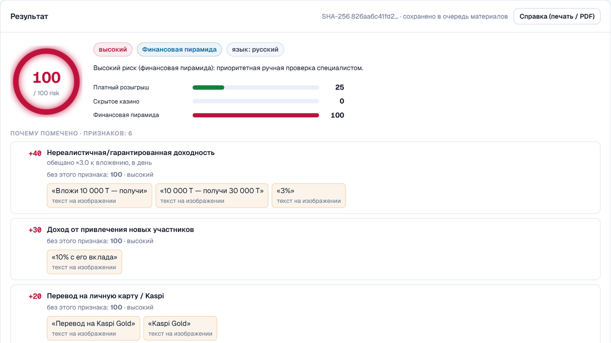

</td>
<td width="50%" valign="top">

**Эфиры и видео.** Речь → текст, кадры → OCR и визуальные теги. Источник указан у каждого признака,
промокод стримера уходит в граф связей.

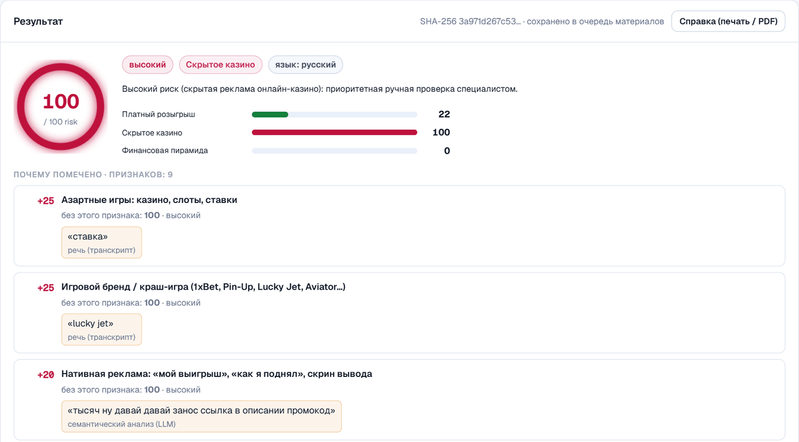

</td>
</tr>
</table>

### Группа целиком: роли и прогрев

Экспорт Telegram (`result.json`) или WhatsApp (`.txt`): риск группы, организатор и кураторы
(как кандидаты для проверки), одинаковые «выплата пришла 🙏» от разных людей.

<table>
<tr>
<td width="55%">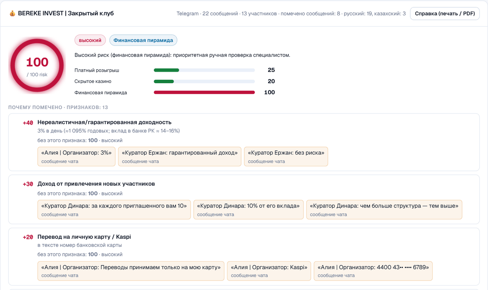</td>
<td width="45%">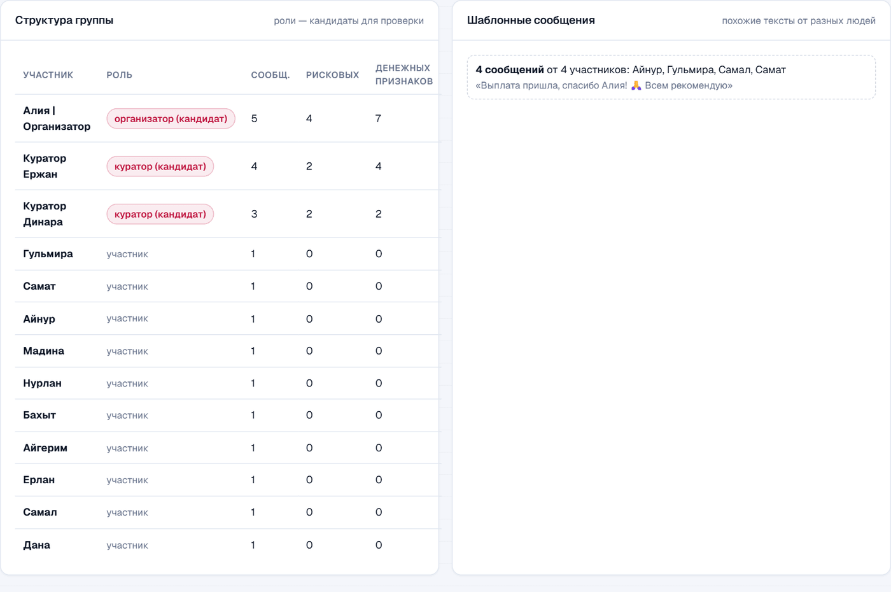</td>
</tr>
</table>

### Кампании: от постов к схеме

Один промокод `SHYM777` связал 5 казино-аккаунтов на 4 платформах; одна Kaspi-карта — кураторов
пирамиды и Telegram-группу в сеть из 16 объектов. Сообщества и центральные узлы считаются в Neo4j GDS.

<table>
<tr>
<td width="50%">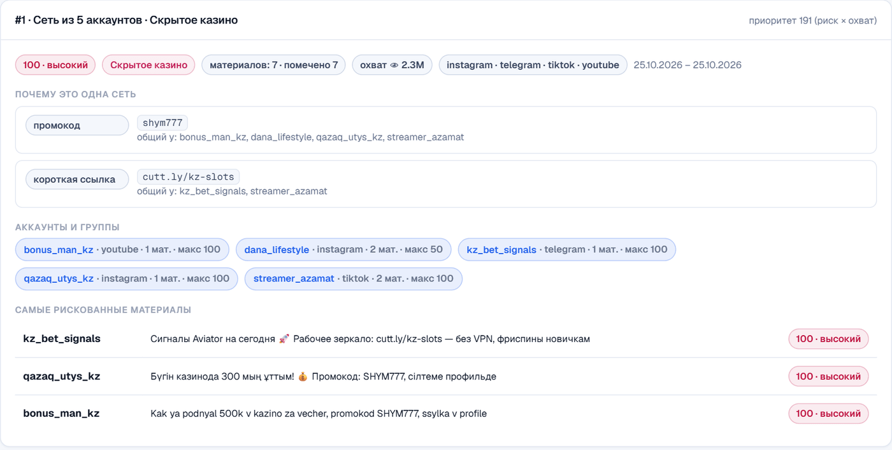</td>
<td width="50%">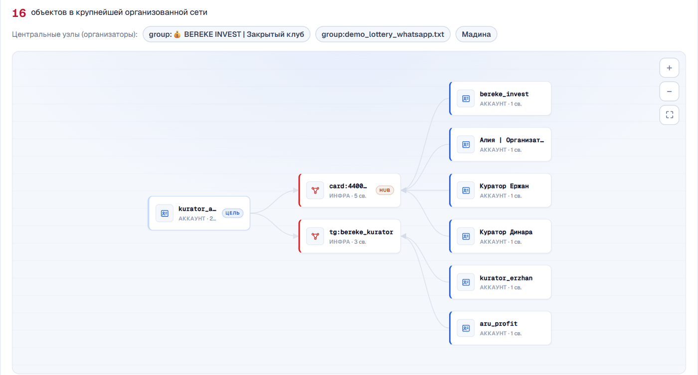</td>
</tr>
</table>

### Масштаб, качество и адаптация

<table>
<tr>
<td width="50%" valign="top">

**Массовая проверка** CSV / JSONL / TXT до 50 000 постов — около 500 постов в секунду на одном
процессе, без LLM и внешних API.

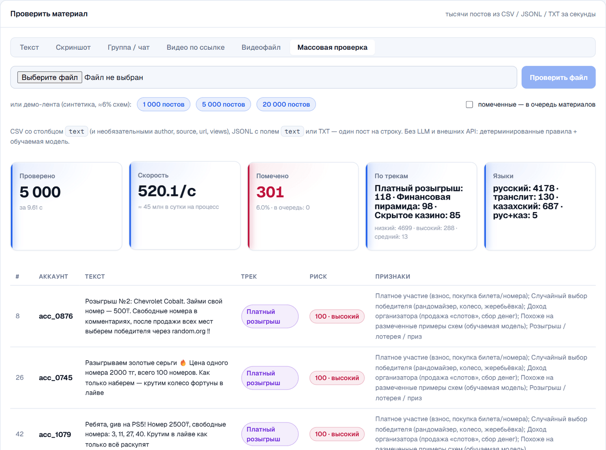

</td>
<td width="50%" valign="top">

**Метрики прямо в интерфейсе** — по каждой выборке и треку, правила и правила + модель.

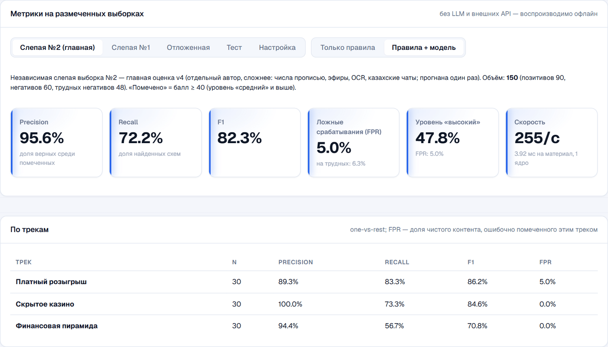

</td>
</tr>
</table>

<table>
<tr>
<td width="62%" valign="top">

**Адаптация.** Слова, которые часто встречаются у разных аккаунтов в рискованных материалах, но ещё
не покрыты методикой, — кандидаты в словарь. Плюс точность каждого признака по решениям аналитиков.

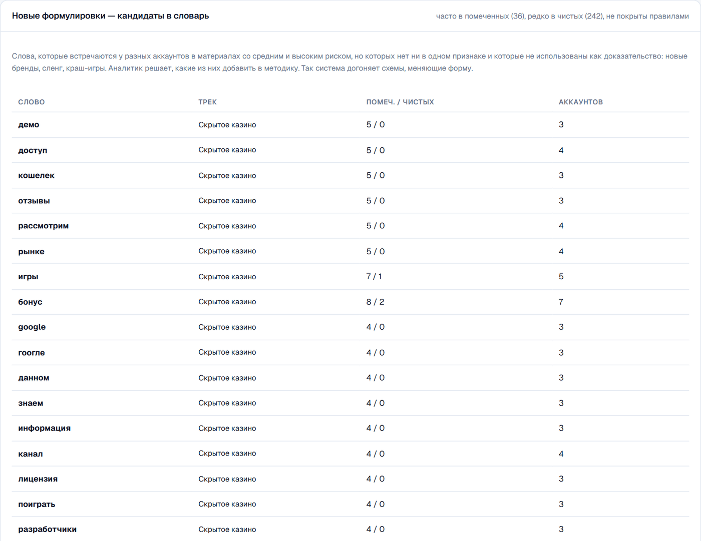

</td>
<td width="38%" valign="top">

**AI-ассистент.** «Сводка по @аккаунт», «топ материалов», «открой граф» — ассистент сам вызывает
инструмент; числа берутся из базы, а не из генерации.

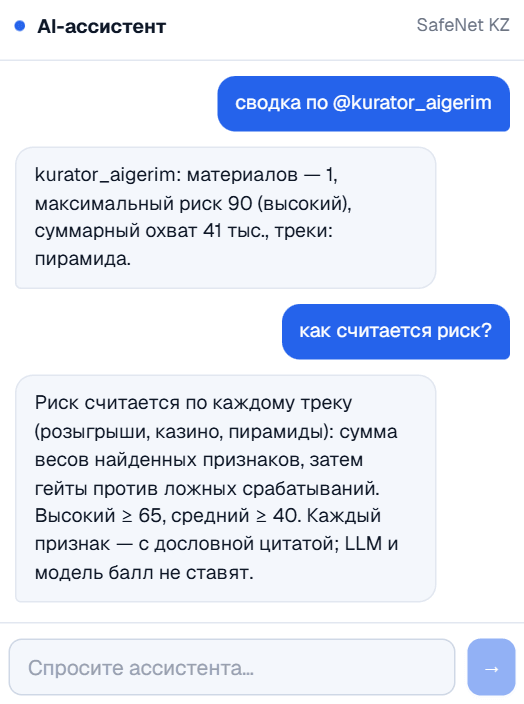

</td>
</tr>
</table>

---

## ⚙️ Как это работает

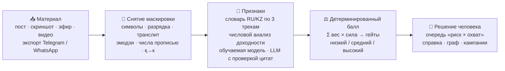

- **LLM и модель никогда не ставят балл.** Они только предлагают признак, и его цитата обязана
  дословно встречаться в тексте — иначе находка отбрасывается.
- **Балл — прозрачная формула**: веса признаков, гейты и смягчения видны строками, Σ вкладов = балл.
  Высокий ≥ 65, средний ≥ 40.
- **Работает без внешнего AI.** Правила, OCR, числовой анализ и граф — on-prem. Если ключ OpenAI без
  квоты, срабатывает предохранитель и система 10 минут работает только на правилах.

---

## 📊 Честные метрики

Каждую новую выборку прогоняли **один раз вслепую**; правила на слепых выборках не настраивались,
модель на них не обучалась. Последнюю выборку (150 примеров) написал независимый автор, не видевший
правил: числа прописью, эфиры, OCR, казахские чаты.

| Выборка | Версия | Precision | Recall | FPR |
|---|---|:-:|:-:|:-:|
| test | v1 | 100.0% | 65.3% | 0.0% |
| holdout | v2 | 90.2% | 76.7% | 8.3% |
| blind | v3 | 96.6% | 63.3% | 3.3% |
| blind2 | v4 · правила | 94.9% | 62.2% | 5.0% |
| **blind2** | **v4 · правила + модель** | **95.6%** | **72.2%** | **5.0%** |

**Главная оценка v4** (правила + модель, без LLM): precision **95.6%**, recall **72.2%**, F1 **82.3%**,
FPR **5.0%**. По трекам:

| Трек | Precision | Recall | F1 | FPR |
|---|:-:|:-:|:-:|:-:|
| 🎟️ Платный розыгрыш | 89.3% | 83.3% | 86.2% | 5.0% |
| 🎰 Скрытое казино | 100.0% | 73.3% | 84.6% | 0.0% |
| 📈 Финансовая пирамида | 94.4% | 56.7% | 70.8% | 0.0% |

Слабое место — пирамиды в незнакомом стиле; план — дообучение на решениях аналитиков.
Протокол и история всех прогонов — в [docs/METRICS.md](docs/METRICS.md).

---

## 🚀 Быстрый старт

```bash
cp .env.example .env              # секреты; OPENAI_API_KEY необязателен (только синтетика!)
docker compose up --build -d      # весь стек
docker compose exec backend alembic upgrade head
docker compose exec backend python -m scripts.seed_demo        # аналитик analyst-1 (печатает пароль)
```

Откройте http://localhost:5173 → «Обзор» → **«Загрузить демо»** (синтетические аккаунты, сети и группы).

> [!TIP]
> Без внешнего AI: «Настройки» → AI-провайдер = `mock`. Правила, OCR (Tesseract) и граф работают офлайн.
> Демо-скриншоты для загрузки — в [docs/demo_screenshots/](docs/demo_screenshots/), демо-группы
> выбираются кнопками на вкладке «Проверка контента → Группа / чат».

> [!NOTE]
> Автосбор из источников запускается и останавливается **только кнопкой** в «Мониторинге».

### Метрики и тесты

```bash
docker compose exec backend python -m scripts.evaluate_safenet --set all      # все выборки
docker compose exec backend python -m scripts.evaluate_safenet --set blind --errors
docker compose exec backend python -m pytest -q -m "not integration"          # бэкенд
docker compose exec frontend npx vitest run                                   # фронтенд
```

---

## 🧱 Устройство

```
backend/app/services/safenet/
  normalize.py   виды текста против обфускации, свёртка казахских букв, транслит, язык
  lexicon.py     признаки трёх треков (RU/KZ/translit/сленг), веса, исключения
  numeric.py     доходность «вложи→получи», % за период, номера карт (Луна), маскирование
  numwords.py    числа прописью RU/KZ и денежный сленг → цифры
  model.py       обучаемый слой (наивный Байес), объяснимый, обучен только на dev/test/holdout
  detector.py    признаки с цитатами по сегментам (подпись/речь/OCR/чат) + LLM с проверкой цитат
  scoring.py     детерминированный балл по трекам, гейты, смягчения, уровни
  group.py       разбор экспортов Telegram/WhatsApp, шаблоны, роли, риск группы
  campaigns.py   сети аккаунтов по общим идентификаторам и шаблонам
  insights.py    новые формулировки + качество признаков по решениям аналитиков
  bulk.py        массовая проверка CSV/JSONL/TXT
  evaluation.py  precision / recall / F1 / FPR, срезы, матрица ошибок, скорость
  demo.py        синтетические аккаунты-сети и группы для демо
  data/          dev / test / holdout / blind / blind2 выборки, демо-чаты
frontend/src/features/safenet/   Проверка контента, анализ группы, кампании, метрики, адаптация
```

**Стек:** FastAPI · Celery · PostgreSQL · Neo4j (GDS) · Qdrant · Redis · MinIO (WORM, цепочка хранения
доказательств) · Temporal · React + TypeScript + TanStack Query · Tesseract · ffmpeg · yt-dlp / Telethon.
AI-провайдер абстрагирован: `openai | anthropic | local | mock`. Подробнее — [ARCHITECTURE.md](ARCHITECTURE.md).

---

## 🤝 Этика

- 🔒 Только синтетические и обезличенные данные; во внешние API уходит только синтетика.
- 💳 Номера карт маскируются, роли в группах помечены как **кандидаты**.
- 🧑‍⚖️ Каждое решение принимает человек; все действия пишутся в журнал аудита.
- 🚫 Система не содержит функций, помогающих организовывать схемы, — только находит признаки и объясняет их.
